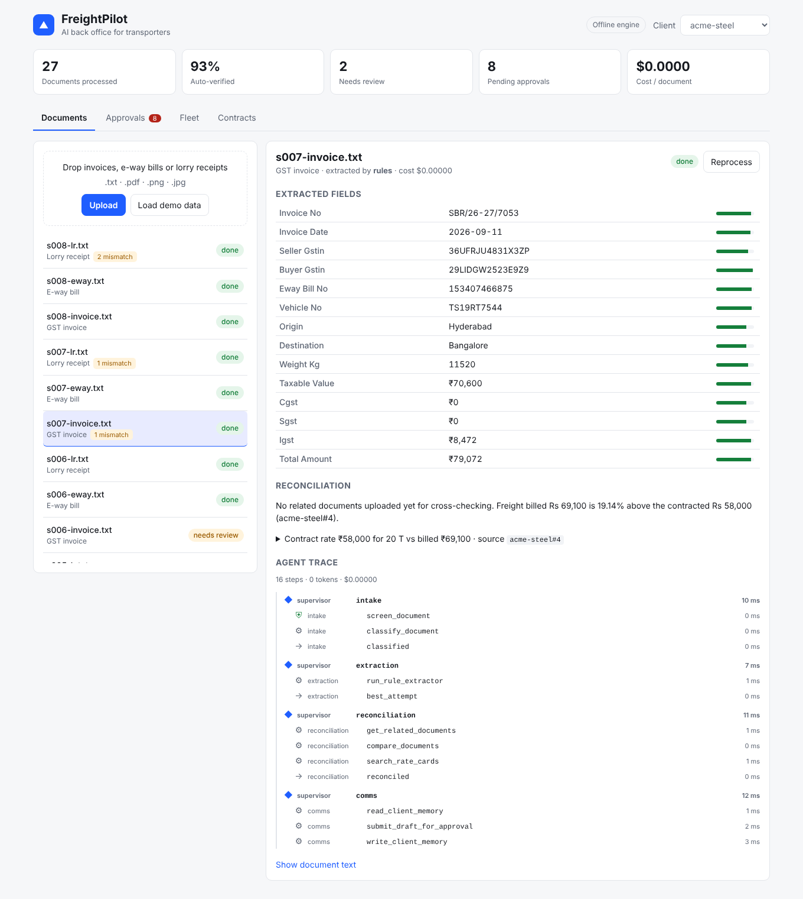

# FreightPilot

**A multi-agent AI back office for Indian transporters.** Forward it GST invoices, e-way bills and lorry receipts. It extracts every field, checks it against GST rules, cross-checks each document against the rest of the shipment and the client's contract, catches overbilling, watches trucks on the road, and drafts client emails. **A human approves anything that leaves the building.**



---

## Why this exists

Small and mid-size transporters run on paper: lorry receipts, e-way bills and GST invoices, often photographed on a phone. Someone types them in, checks them by hand, and finds billing mistakes weeks later. FreightPilot automates that desk, and it is built around one rule:

> **Use plain code where the steps are known, an agent where a decision is needed, and a human where a mistake would cost money.**

## Architecture

```
  Upload (UI / REST API)                        GPS pings + yard camera
            │                                            │
     ┌──────▼──────┐   LangGraph supervisor       ┌──────▼───────┐
     │   INTAKE    │   (checkpointed per run)     │ FLEET MONITOR│  analyse_trip → predict_delay_risk
     │ PII redact  │                              │    agent     │  → get_yard_events → decide:
     │ injection   │                              └──────┬───────┘    update_eta / driver call / alert
     │ classify    │                                     │
     └──────┬──────┘                                     │
     ┌──────▼──────┐  rules → fine-tuned Donut → Claude  │
     │ EXTRACTION  │  stop at the first tier that passes │
     │   agent     │  validators; then a Claude repair   │
     └──────┬──────┘  loop, grounded in the source text  │
     ┌──────▼──────┐                                     │
     │RECONCILIATION  cross-doc checks + hybrid RAG      │
     │   agent     │  over contracts, cited chunk ids    │
     └──────┬──────┘                                     │
     ┌──────▼──────┐                                     │
     │   COMMS     │◄────────────────────────────────────┘
     │   agent     │  drafts in each client's remembered style
     └──────┬──────┘  one thread per shipment, never sends
     ┌──────▼──────┐
     │  APPROVALS  │  human approves → outbox (the only send path)
     └─────────────┘
```

| Agent | Plain code does | The model decides |
|---|---|---|
| Intake | PII redaction, injection scan, keyword classification | Doc type, only when keywords are ambiguous (cheap model) |
| Extraction | Rules, OCR repair, GSTIN checksum, GST maths, escalation order | Which fields are OCR mistakes vs real errors on the paper; proposes fixes, which must appear in the source text |
| Reconciliation | Matching vehicle, invoice, e-way bill, weight, goods value; rate lookup | Plain-English explanation, citing only retrieved chunk ids |
| Fleet monitor | Stops, deviation, ETA maths, delay-risk model | Which actions to take, in what order (checks yard camera before calling the driver) |
| Comms | Memory lookup, thread merging, approval gate | Wording, in the client's tone and language |

## Coverage of the job description (Jr. AI Engineer)

| The JD asks for | Where it is |
|---|---|
| Develop / adapt models for **document processing** | `app/tools/extractors.py`, `training/finetune_donut.py`, `training/make_donut_dataset.py` |
| **Truck tracking** and logistics | `app/tools/fleet.py`, `app/tools/vision.py` (YOLO + ByteTrack + plate OCR + dwell time) |
| Computer vision | `app/tools/vision.py`; plate repair and gate-crossing logic unit-tested |
| Fine-tune models | Donut (documents), LoRA on a 0.5B LLM (`training/finetune_lora.py`), gradient boosting (`app/tools/delay_model.py`) |
| Integrate LLMs into workflows | `app/llm.py`: structured outputs, strict tools, refusal fallback, cost tracking |
| **Retrieval pipelines** | `app/tools/retrieval.py`: BM25 + TF-IDF, reciprocal rank fusion, table-aware chunking, citations |
| Model serving | FastAPI (`app/main.py`), MCP server (`app/mcp_server.py`) |
| Full-stack: UI, APIs, data | React + TypeScript (`frontend/`), FastAPI, SQLAlchemy (SQLite / Postgres) |
| Tests, code review | 75 pytest tests, ruff, GitHub Actions; evals gate every push |
| Debug end to end | Every step is a trace span (model, tokens, cost, latency), viewable live over SSE |
| Python **and** TypeScript | Backend and frontend |
| Git, HTTP, REST | Throughout |

**Agentic skills:** tool calling with strict schemas, a multi-agent supervisor (LangGraph), planning, self-correction loops, short-term graph state plus long-term per-client memory, RAG, an MCP server, human-in-the-loop, guardrails (prompt injection, PII, least-privilege tools), evals in CI, tracing and cost tracking, idempotency and multi-tenancy.

## Results

`python -m evals.run_evals` runs on every push and fails the build on regression. Offline engine, 120 clean documents across 40 shipments, 30 degraded "bad phone scan" documents, and 6 fleet scenarios:

| Metric | Value |
|---|---|
| Field accuracy, clean documents | 100% |
| Field accuracy, degraded documents | 94.9% |
| **Silent error rate on degraded documents** (marked done but wrong) | **0%** (was 40% before the fix below) |
| Degraded documents routed to a human | 63% |
| GST rule violations caught (arithmetic, wrong tax type) | 100%, with 0 false alarms |
| Overbilling and vehicle mismatches caught across a shipment | 100%, with 0 false alarms |
| Prompt injections caught | 100%, with 0 false alarms |
| Driver phone numbers redacted before any LLM call | 100% |
| Fleet agent picked the right actions | 6/6 scenarios |
| Delay model vs naive ETA rule (simulated trips) | 94.8% vs 90.1% accuracy, AUC 0.99 |

**The most important number is the silent error rate.** The first eval run showed 40% of degraded documents being auto-approved with a wrong or missing field, because "required fields" was too narrow. Widening it to every field that downstream checks rely on took silent errors to 0%, at the cost of more human reviews. The Claude extraction tier exists to bring that review rate down without bringing silent errors back.

**Honest limits.** These numbers come from synthetic documents generated by `evals/dataset.py`. They prove the pipeline works and stop regressions, not real-world accuracy. The next step is a golden set of 150–300 real, labelled scans (see below).

## Engineering decisions worth asking about

- **Grounded self-correction.** The extraction agent may fix OCR mistakes, but a correction is accepted only if its value literally appears in the document. The model cannot invent a number to make a GSTIN checksum pass. Tested in `test_repair_loop_rejects_corrections_not_in_document`.
- **Documents are untrusted input.** Text is fenced in `<document>` tags with fake closing tags neutralised, scanned for injection, and every agent has a tool allowlist. The comms agent cannot send; only the approvals endpoint writes to the outbox. Tested with a scripted fake model that tries to call a forbidden tool.
- **Aadhaar vs e-way bill.** Both are 12 digits. The redactor uses the Verhoeff checksum plus the label context, so e-way bill numbers survive and Aadhaar numbers do not.
- **One email per shipment.** The invoice and the lorry receipt can both reveal the same overcharge. Findings are threaded by invoice number into one pending draft. This was a real bug, found by looking at the UI.
- **Checkpoint per run, not per document.** Reprocessing a document with a per-document thread inherited stale state from the last run. Caught by a test; fixed with `thread_id = doc-<id>-<run_id>`.
- **Cheapest tier first.** Rules cost nothing and handle typed documents. Claude is called only when validators fail, and the trace shows the cost of every call.

## Run it

```bash
# Backend (Python 3.11+)
cd backend
python -m venv .venv && . .venv/bin/activate
pip install ".[dev]"
python -m training.train_delay_model
uvicorn app.main:app --reload          # http://localhost:8000/docs

# Frontend
cd frontend && npm install && npm run dev   # http://localhost:5173, click "Load demo data"

# Everything, with Postgres
docker compose up --build                # http://localhost:8080
```

With no `ANTHROPIC_API_KEY`, everything runs on the deterministic offline engine: free, and what CI uses. Set the key and the same agents run on Claude (`FP_MODEL`, default `claude-opus-5-5`; `FP_FAST_MODEL` for classification, default `claude-haiku-5-5`).

```bash
pytest -q                                   # 75 tests
python -m evals.run_evals                   # offline evals
FP_LLM_MODE=claude python -m evals.run_evals  # same evals on Claude (costs money)
python -m app.mcp_server                    # MCP server over stdio
```

**Multi-tenancy:** set `FP_API_KEYS="acme-steel:key1,deccan-pharma:key2"`. The key decides the tenant; a query parameter cannot override it.

**Optional extras:** `pip install ".[ocr]"` (Tesseract), `".[vision]"` (YOLO, ByteTrack, EasyOCR), `".[train]"` (Donut and LoRA fine-tuning, GPU recommended).

## What is verified and what is not

| Part | Status |
|---|---|
| Offline pipeline, API, SSE, approvals, tenancy, MCP tools, fleet agent | Tested (pytest + evals) and checked in a real browser |
| Claude tool loop, permission denial, grounded repair | Tested with a scripted fake client |
| Claude against the live API | **Not run yet.** Needs an API key: run the Claude evals and record the numbers here |
| Donut / LoRA fine-tuning, YOLO video pipeline | Scripts written, **not run** (need a GPU and model downloads). Dataset rendering is tested |
| Docker images | Written, **not built yet** |

## Next steps

1. **Real golden set.** Photograph 150–300 real lorry receipts and invoices (blur personal data), label them, and replace the synthetic numbers above.
2. **A real user.** Run it for a transport office for two weeks and report documents processed and errors caught.
3. Run the Claude evals and publish the cost per document next to accuracy.
4. Durable job queue (Redis + a worker) and a persistent LangGraph checkpointer (Postgres) instead of in-memory.
5. Alembic migrations, WhatsApp intake, a Telugu/Hindi document set.

## Layout

```
backend/
  app/agents/      intake, extraction, reconciliation, fleet_monitor, comms, supervisor (LangGraph)
  app/tools/       ocr, extractors, retrieval (RAG), fleet, delay_model, vision
  app/             llm (Claude layer), guardrails, validators, tracing, db, main (API), mcp_server
  evals/           dataset generator, eval runner, thresholds
  training/        Donut dataset + fine-tune, LoRA fine-tune, delay model
  tests/           pytest suite
frontend/          React + TypeScript (Vite)
```
